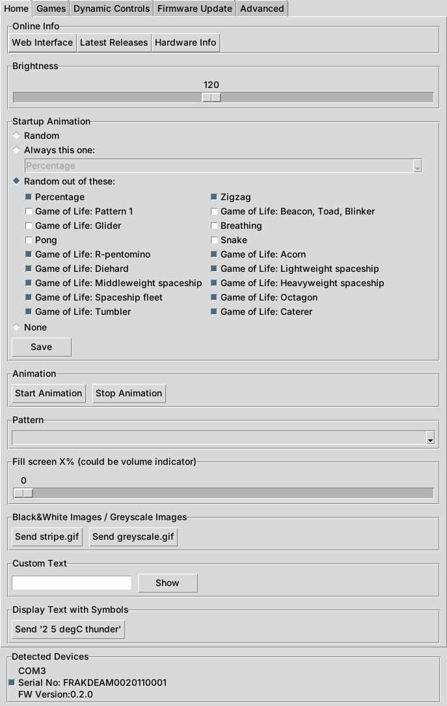
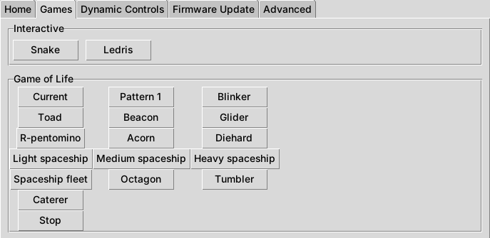

# Framework Laptop 16 - Input Module Firmware/Software

## About this fork

This is kingof9x's fork of [Framework's inputmodule-rs](https://github.com/FrameworkComputer/inputmodule-rs).
It is **not a rewrite**: everything from Framework's version is still here and
works the same way. The changes are all about the **LED Matrix** module. The
other modules (2nd Display, C1 Minimal) are untouched.

### ⬇ Downloads

[Latest version](https://github.com/kingof9x/inputmodule-rs/releases/latest) ·
[ledmatrixgui.exe](https://github.com/kingof9x/inputmodule-rs/releases/latest/download/ledmatrixgui.exe) (Windows app) ·
[ledmatrix.uf2](https://github.com/kingof9x/inputmodule-rs/releases/latest/download/ledmatrix.uf2) (LED Matrix firmware) ·
[inputmodule-control.exe](https://github.com/kingof9x/inputmodule-rs/releases/latest/download/inputmodule-control.exe) (Windows command line tool)

### What's different from Framework's version

**LED Matrix firmware (`ledmatrix.uf2`)**

- **Choose the startup animation.** Framework's firmware always shows a random
  animation when the laptop turns on. Here you can pick one animation to always
  show, a random one out of a set you choose, a random one out of all of them,
  or none. The choice is saved on the module and kept after power off.
  (New command `0x21`, see [commands.md](commands.md). It's stored in its own
  flash sector, see [flash_layout.md](flash_layout.md).)
- **10 new Game of Life patterns:** R-pentomino, Acorn, Diehard, light, medium
  and heavy spaceships, a spaceship fleet, Octagon, Tumbler and Caterer. They
  can be played from the Games tab and used as startup animations.
- **4 more Game of Life patterns, Pattern 2 to Pattern 5.** Like Pattern 1,
  they start with the whole matrix filled with a dotted texture that breaks
  into chaos and settles after about 2 minutes. Also in the Games tab and the
  startup animation list.
- **Built on Framework's official 0.2.0 firmware.** Framework's newer,
  unreleased code updates the USB and LED libraries, and with it the matrix
  flickers when a system monitor app keeps updating it. This fork's firmware
  still reports version 0.2.0.


*Where each new pattern starts on the matrix. Drawn from the firmware's own pattern data, not a photo.*

**Windows app (`ledmatrixgui.exe`) and Python library**

- *Startup Animation* settings on the Home tab.
- The new Game of Life patterns on the Games tab.
- *Installed Firmware* box on the Firmware Update tab: shows each module's
  firmware version and whether it supports the startup animation setting.
- Fixed: *Enter Bootloader* didn't do anything.
- Fixed: the bundled firmware update failed on newer Windows versions,
  which no longer include `wmic`.
- Says when another program (like a system monitor) is using a module,
  instead of "not supported", and picks the module up again once that program
  lets go of it. On Windows only one program at a time can talk to a module.
- Notes that the bundled firmware update is Framework's official firmware,
  with a link to its release notes.

**Command line tools (`inputmodule-control` and `ledmatrixctl`)**

- `--startup-animation` and `--startup-animation-set` options.
- The new patterns for `--start-game game-of-life --game-param ...`.

| Home tab | Games tab |
|---|---|
|  |  |


*Screenshots of this fork's app, taken on Linux with a simulated module, so the
window looks a little different from Windows.*

### Install

**1. The app.** Download [`ledmatrixgui.exe`](https://github.com/kingof9x/inputmodule-rs/releases/latest/download/ledmatrixgui.exe)
and run it, nothing needs installing. If Windows shows *"Windows protected your
PC"*, click *More info* > *Run anyway* (the app isn't code-signed).

**2. The firmware.** The app works with Framework's official firmware too, but
the startup animation setting and the new patterns need this fork's firmware:

1. Close other programs that use the LED Matrix, such as a system monitor app.
2. Download [`ledmatrix.uf2`](https://github.com/kingof9x/inputmodule-rs/releases/latest/download/ledmatrix.uf2).
3. Open `ledmatrixgui.exe`, go to the **Firmware Update** tab and click
   **Enter Bootloader**. The matrix goes dark and a drive called `RPI-RP2`
   appears (one per module if you have two selected).
4. Copy `ledmatrix.uf2` onto each `RPI-RP2` drive. The drive disappears and
   the module restarts with the new firmware.
5. Restart `ledmatrixgui.exe`. The **Installed Firmware** box should now say
   *"startup animation setting supported"*.

**Going back to Framework's firmware:** on the **Firmware Update** tab, pick
the version under *Bundled Updates* and click **Update**. Your startup choice
stays in flash but Framework's firmware ignores it.

On Linux, install the Python app with `pip install ./python` from this
repository and run `ledmatrixgui`, see [python/README.md](python/README.md).

### How to use it

**Startup animation (Home tab)**

1. Under *Startup Animation*, choose:
   - **Random**: a random one of all 22 animations every time,
   - **Always this one**: pick one from the list,
   - **Random out of these**: tick the ones you like,
   - **None**: no animation, the matrix stays dark until an app uses it.
2. Click **Save**. The matrix plays the chosen animation once so you can see it.
3. The setting goes to all modules ticked under *Detected Devices* at the bottom.

**Game of Life patterns (Games tab):** click a pattern to start it, **Stop** to end it.

**Command line** (`inputmodule-control.exe` on Windows):

```sh
# Show the current setting
inputmodule-control led-matrix --startup-animation
# Always show the same animation
inputmodule-control led-matrix --startup-animation gol-acorn
# Random out of a set
inputmodule-control led-matrix --startup-animation-set snake,pong,gol-octagon
# Back to the default, or no animation at all
inputmodule-control led-matrix --startup-animation random
inputmodule-control led-matrix --startup-animation none
# Play a new pattern
inputmodule-control led-matrix --start-game game-of-life --game-param spaceship-fleet
```

The Python command line tool takes the same options: `ledmatrixctl --startup-animation gol-acorn`.

### Testing checklist

Ticked items have been confirmed on a real Framework Laptop 16 (Windows, two
LED Matrix modules). The rest pass the automated builds but haven't been
checked on hardware yet. Tick them off as they're confirmed.

**Firmware**
- [ ] Flashing `ledmatrix.uf2` through *Enter Bootloader* + copying to `RPI-RP2` works on both modules
- [x] No flicker while a system monitor app drives the matrix (0.2.0 base)
- [x] *Always this one*: the chosen animation plays at every power on
- [ ] *Random out of these*: only ticked animations show up over several restarts
- [ ] *Random*: still picks different animations
- [ ] *None*: no animation, the matrix stays dark until an app uses it
- [ ] The setting survives a full shutdown, not just a restart
- [ ] Each new Game of Life pattern plays as a startup animation
- [ ] Sleep and wake (lid close / open) still work as before
- [ ] Going back to Framework's firmware with the bundled update works, and coming back to this firmware keeps the saved setting

**Windows app**
- [x] *Enter Bootloader* puts the selected module into bootloader mode
- [x] The bundled firmware update finds the `RPI-RP2` drive and flashes it
- [ ] *Installed Firmware* shows the right version and "supported" / "not supported"
- [ ] Each new pattern on the Games tab starts, and *Stop* ends it
- [ ] *Save* on the Home tab plays the chosen animation and the setting is remembered after reopening the app
- [ ] With a system monitor app running, the app says "In use by another program", and picks the module up within a few seconds of closing the monitor
- [ ] With Framework's official firmware, the Startup Animation box says "Needs a firmware update"

**Command line**
- [ ] `inputmodule-control led-matrix --startup-animation` (no value) prints the current setting
- [ ] Setting a fixed animation, a set, `random` and `none` all work
- [ ] `--start-game game-of-life --game-param ...` works for the new patterns

### Plan for Framework

The goal is to offer these changes back to Framework in a few small pull
requests, each one based on Framework's latest code:

1. GUI fixes: *Enter Bootloader* and the bundled update without `wmic`.
2. Startup animation setting (*Random* keeps picking from the original 8 animations).
3. New Game of Life patterns.

Fork-only things stay here: the download links and release workflow, and
building the firmware on 0.2.0. Framework's pull requests go on top of their
newer code, so the flicker there is something to report to them separately.

---

This repository contains both the firmware for the Framework Laptop 16 input modules,
as well as the tool to control them.

Rust firmware project setup based off of: https://github.com/rp-rs/rp2040-project-template

## Modules

See pages of the individual modules for details about how they work and how
they're controlled.

- [LED Matrix](ledmatrix/README.md)
- [Minimal C1 Input Module](c1minimal/README.md)
- [2nd Display](b1display/README.md)
- [QT PY RP2040](qtpy/README.md)

## Generic Features

All modules are built with an RP2040 microcontroller
Features that all modules share

- Firmware written in bare-metal Rust
- Reset into RP2040 bootloader when firmware crashes/panics
- Sleep Mode to save power
- API over USB ACM Serial Port - Requires no Drivers on Windows and Linux
  - Go to sleep
  - Reset into bootloader
  - Control and read module state (brightness, displayed image, ...)

## Control from the host

To build your own application see the: [API command documentation](commands.md)

Or use our `inputmodule-control` app, which you can download from the latest
[GH Actions](https://github.com/FrameworkComputer/inputmodule-rs/actions) run or
the [release page](https://github.com/FrameworkComputer/inputmodule-rs/releases).

For device specific commands, see their individual documentation pages.

### GUI and Python
There are also a python library and GUI tool. See their [README](python/README.md).


###### Permissions on Linux
To ensure that the input module's port is accessible, install the `udev` rule and trigger a reload:

```sh
sudo cp release/50-framework-inputmodule.rules /etc/udev/rules.d/
sudo udevadm control --reload && sudo udevadm trigger
```

##### Common commands:

###### Listing available devices

```sh
> inputmodule-control --list
/dev/ttyACM0
  VID     0x32AC
  PID     0x0020
  SN      FRAKDEAM0020110001
  Product LED_Matrix
/dev/ttyACM1
  VID     0x32AC
  PID     0x0021
  SN      FRAKDEAM0000000000
  Product B1_Display
```

###### Apply command to single device

By default a command will be sent to all devices that can be found, to apply it
to a single device, specify the COM port.
In this example the command is targeted at `b1-display`, so it will only apply
to this module type.

```sh
# Example on Linux
> inputmodule-control --serial-dev /dev/ttyACM0 b1-display --pattern black

# Example on Windows
> inputmodule-control.exe --serial-dev COM5 b1-display --pattern black
```

###### Send command when device connects

By default the app tries to connect with the device and aborts if it can't
connect. But you might want to start the app, have it wait until the device is
connected and then send the command.

```
> inputmodule-control b1-display --pattern black
Failed to find serial device. Please manually specify with --serial-dev

# No failure, waits until the device is connected, sends command and exits
> inputmodule-control --wait-for-device b1-display --pattern black

# If the device is already connected, it does nothing, just wait 1s.
# This means you can run this command by a system service and restart it when
# it finishes. Then it will only ever do anything if the device reconnects.
> inputmodule-control --wait-for-device b1-display --pattern black
Device already present. No need to wait. Not executing command.
```

## Update the Firmware

First, put the module into bootloader mode.

This can be done either by pressing the bootsel button while plugging it in or
by using one of the following commands:

```sh
inputmodule-control led-matrix --bootloader
inputmodule-control b1-display --bootloader
inputmodule-control c1-minimal --bootloader
```

Then the module will present itself in the same way as a USB thumb drive.
Copy the UF2 firmware file onto it and the device will flash and reset automatically.
Alternatively when building from source, run one of the following commands:

```sh
cargo run -p ledmatrix
cargo run -p b1display
cargo run -p c1minimal
```

## Building the firmware

Dependencies: [Rust/rustup](https://rustup.rs/), pkg-config, libudev

Prepare Rust toolchain (once):

```sh
rustup target install thumbv6m-none-eabi
cargo install flip-link --locked
cargo install cargo-make --locked
cargo install elf2uf2-rs --locked
```

Build:

```sh
cargo make --cwd ledmatrix
cargo make --cwd b1display
cargo make --cwd c1minimal
```

Generate the UF2 update file into `target/thumbv6m-none-eabi/release/`:

```sh
cargo make --cwd ledmatrix uf2
cargo make --cwd b1display uf2
cargo make --cwd c1minimal uf2
```

## Building the Application

Dependencies: [Rust/rustup](https://rustup.rs/), pkg-config, libudev

Currently have to specify the build target because it's not possible to specify a per package build target.
Tracking issue: https://github.com/rust-lang/cargo/issues/9406

```sh
# Install cargo-make to help build it
cargo install cargo-make --locked

# Build it
> cargo make --cwd inputmodule-control

# Build and run it, showing the tool version
> cargo make --cwd inputmodule-control run -- --version
```

### Check the firmware version of the device

###### In-band using commandline

```sh
> inputmodule-control led-matrix --version
Device Version: 0.2.0
```

###### By looking at the USB descriptor

On Linux:

```sh
> lsusb -d 32ac: -v 2> /dev/null | grep -P 'ID 32ac|bcdDevice'
Bus 003 Device 078: ID 32ac:0021 Framework Laptop 16 B1 Display
  bcdDevice            0.10
```

## Rust Panic

When the Rust code panics, the RP2040 resets itself into bootloader mode.
This means a new firmware can be written to overwrite the old one.

Additionally the panic message is written to XIP RAM, which can be read with [picotool](https://github.com/raspberrypi/picotool):

```sh
sudo picotool save -r 0x15000000 0x15004000 message.bin
strings message.bin | head
```

## Project status

**Status:** Waiting on Callum  
**Waiting on:** Callum: finish testing, then submit upstream  
**Notes:** Fork of Framework's LED Matrix firmware and control app. Goal: send the changes upstream.  
**Last updated:** 2026-10-28

### Task list

- [ ] Prepare and format the upstream pull request (Claude can help) (blocked)
- [ ] Submit the pull request to FrameworkComputer/inputmodule-rs (blocked)

